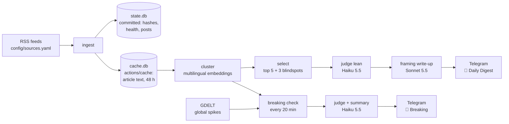

# Architecture

A Telegram bot that posts a daily digest showing how left, right and international outlets frame
the same news story, plus conservative breaking-news alerts. Each choice below links to the ADR
(Architecture Decision Record) that explains why.

> **Status:** design approved, sources done. Code is being built module by module (see
> [Build order](#build-order)). Sections marked *(planned)* aren't built yet.

## Pipeline



Two GitHub Actions schedules share one pipeline ([ADR 0004](adr/0004-hosting-github-actions-and-sqlite.md)):

| Job | When | What it does |
|---|---|---|
| `digest.yml` | Daily, scheduled ~06:45 IST so it lands by 07:00 | Full pipeline → 8 messages to 📰 Daily Digest |
| `breaking.yml` | Every 20 minutes | Ingest + cluster + breaking check → 🚨 Breaking (rarely posts) |

Both jobs share a `concurrency` group so they never write `state.db` at the same time.

State is split in two ([ADR 0005](adr/0005-ingest-store-and-feed-health.md)). `data/state.db` is
committed and holds only small records: URL hashes, feed health and posted stories.
`data/cache.db` holds article titles and RSS summaries for 48 hours. It is gitignored and kept
between runs with `actions/cache`, so outlets' text never enters the public repo.

## Modules

| Module | Job | Owner |
|---|---|---|
| `config/sources.yaml` | Outlets, baseline lean, ownership, fact-check notes ([ADR 0001](adr/0001-news-sources-rss-and-gdelt.md)) | Project owner decides; Claude drafts |
| `ingest.py` | Fetch feeds, clean up URLs, dedupe, record feed health | Claude |
| `store.py` | SQLite access: articles, stories, posts, feed health, spend | Claude |
| `gdelt.py` | Global coverage spikes for breaking news | Claude |
| `embed.py` | Turn articles into vectors, reusing cached ones ([ADR 0006](adr/0006-clustering-embeddings-and-stories.md)) | Claude |
| `cluster.py` | Group articles about the same event, across languages | **Project owner decides; Claude writes** |
| `select.py` | Rank stories, pick blindspots, decide breaking | **Project owner decides; Claude writes** |
| `prompts/judge.md` | The lean-judging rubric ([ADR 0002](adr/0002-lean-judging-ai-with-outlet-baseline.md)) | **Project owner decides; Claude writes** |
| `judge.py`, `summarize.py` | Call the AI models ([ADR 0003](adr/0003-ai-models-haiku-and-sonnet.md)) | Claude |
| `budget.py` | Track spend and enforce the cap | Claude |
| `render.py`, `telegram.py` | Build and send messages | Claude |

## Sources
38 outlets across 7 regions and 9 languages. Each has a `baseline_lean` on one of four axes:
US, UK, national (that country's own left/right) or local (stance toward its own government).
Ownership is `private`, `public_service` (publicly funded with legal editorial independence) or
`state` (🏛). A `reliability_note` is added only where Media Bias/Fact Check rates factual
reporting Mixed or lower, whatever the lean. Full field definitions are in the file header.

A source whose feed dies is turned off with `enabled: false`, not deleted, so its reasoning and
history stay keyed on its id. Global Times was turned off on 2026-10-31 because its only feed had
gone stale, and CGTN took its place.

Feeds are always fetched with an honest User-Agent naming the project. Several sites blocked a
browser-like one but accepted the honest one.

## Feed health *(planned, [ADR 0005](adr/0005-ingest-store-and-feed-health.md))*
- Everything is keyed by source `id`, which is never renamed; changing a feed URL keeps history.
- Article URLs are cleaned up before dedupe (tracking parameters removed, host lowercased,
  fragment dropped), so a new feed URL can't cause duplicate posts.
- Each run records per-source health: last success, newest item date, consecutive failures.
  **Unhealthy** = an error, 0 items, or nothing new in 48 hours. That catches the silent failures:
  a URL that now returns a web page, or a feed that has stopped updating.
- After 3 unhealthy runs in a row, the workflow opens a GitHub Issue for that feed and closes it
  automatically when the feed recovers.
- Redirects are followed and flagged in the issue. `sources.yaml` is never edited automatically.
- If a story lacks a viewpoint because those feeds are down, the message says
  "view unavailable (N feeds offline)" instead of presenting a false blindspot.

## Clustering *(planned, [ADR 0006](adr/0006-clustering-embeddings-and-stories.md))*
- Each article's title + summary is embedded with `paraphrase-multilingual-MiniLM-L12-v2`
  (sentence-transformers), so the same event in different languages lands close together before
  any paid translation. The model reads at most 128 tokens; the title comes first.
- PyTorch is pinned to the CPU-only build: free Actions runners have no GPU, and the model is small.
- Embeddings are stored in `cache.db` with the model name, so each run embeds only new articles.
- Articles are grouped with agglomerative clustering (cosine distance, average linkage, one
  distance threshold); every choice in it is the project owner's.
- Each `Story` has a `story_id` (its earliest article's `url_hash`), its articles, and derived
  properties. Region and lean are looked up from `sources.yaml`, never copied.

## Lean judging *(planned)*
The AI judges all articles in a story together, using a fixed rubric: lean score (-2..+2),
framing tags, loaded words and confidence. It sees each outlet's baseline and must explain any
shift of ±1 or more. Output is structured JSON, checked with pydantic. Only articles in stories
that make the digest are judged (~60–80/day), which keeps cost low.

## Story selection *(planned)*
- **Top 5:** ranked by distinct outlets × regions covered × spread across the spectrum, rotating
  across the four topic areas (world politics, economy, science/tech/climate, culture/society) so
  one topic can't take every slot.
- **3 blindspots:** stories with 3+ articles where 75%+ of coverage comes from one side, plus one
  slot for a story covered only by non-Western outlets. Offline feeds don't count as "not covering".
- **Breaking (conservative):** 8+ outlets across 3+ regions within 2 hours, **and** a GDELT
  volume spike, **and** not posted before. Expect 0–2 a day.

## Telegram
One group with Topics turned on: 📰 Daily Digest · 🚨 Breaking · 💬 Discussion. The bot is an
admin that only posts. v1 has no bot commands, because GitHub Actions can't run an always-on bot;
link buttons work without one.

Each story is one message:

```
📰 Headline (neutral, written by the AI)
2–3 sentence factual summary.

🔵 Left framing: …   🔴 Right framing: …   🌍 International: …
⚠ Loaded language spotted: "…" (Outlet)

[Left take] [Right take] [Local-language source]   ← link buttons
```

Messages use HTML formatting and stay under Telegram's 4,096-character limit.

## Reliability
- **Idempotent posting:** GitHub can re-run a job. Before sending, the digest commits a
  "started" record for the day, then marks each message as sent. A retry sends only what's
  missing, and skips entirely if the day is marked done.
- **State pruning:** rows older than 30 days are deleted so `state.db` stays small.
- **Secrets:** only in GitHub Secrets and a local `.env`. Logs never print keys, tokens or chat
  IDs, because Actions logs are public.

## Cost
- AI budget is $4/month, tracked by `budget.py`. When it's hit, the bot sends a headline-only
  digest and logs a warning.
- A hard spend limit is also set in the Anthropic console as a second safety net.
- Prices are taken from the official docs, never guessed.

## Build order
0. ✅ Setup: uv scaffold, CLAUDE.md, ADRs 0001–0004, hooks, subagents, `/adr`1. ✅ Sources: `config/sources.yaml`
2. Ingest + store + feed health (ADR 0005)
3. Cluster *(owner-decided)*
4. Select *(owner-decided)*
5. Judge + summarize + budget (rubric owner-decided)
6. Render + Telegram + `digest.yml`: **v1 ships**
7. GDELT + `breaking.yml`: **v1.1**
8. Always-on bot on student cloud credits, with `/more`, `/topic`, `/sources`: **v2**

## Development workflow
Each module is designed through questions and options, recorded in an ADR if it's
hard to reverse, built on its own branch, checked (pytest, ruff, pyright and `--dry-run`),
reviewed with `/code-review`, then reviewed and merged by the project owner. Claude Code is the
development partner; the running bot calls the Anthropic API directly. Rules are in
[CLAUDE.md](../CLAUDE.md).
