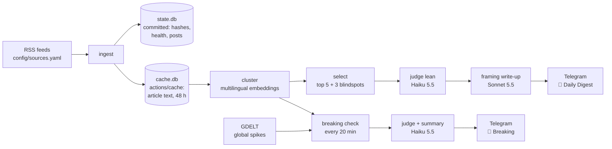

# Architecture

A Telegram bot that posts a daily digest showing how left, right and international outlets frame
the same news story, plus conservative breaking-news alerts. Each choice below links to the ADR
(Architecture Decision Record) that explains why.

> **Status:** steps 0–6 are built: v1 posts a daily digest from GitHub Actions. GDELT and
> breaking alerts come next (see [Build order](#build-order)). Sections marked *(planned)* aren't
> built yet.

## Pipeline



Two GitHub Actions schedules share one pipeline ([ADR 0004](adr/0004-hosting-github-actions-and-sqlite.md)):

| Job | When | What it does |
|---|---|---|
| `digest.yml` | Daily, scheduled ~06:45 IST so it lands by 07:00 | Full pipeline → 8 messages to 📰 Daily Digest |
| `breaking.yml` | Every 20 minutes | Ingest + cluster + breaking check → 🚨 Breaking (rarely posts) |

Both jobs share a `concurrency` group so they never write `state.db` at the same time.

State is split in two ([ADR 0005](adr/0005-ingest-store-and-feed-health.md)). `data/state.db` is
committed and holds only small records: URL hashes, feed health and posted stories.
`data/cache.db` holds article titles and RSS summaries for 48 hours. It is gitignored and kept
between runs with `actions/cache`, so outlets' text never enters the public repo.

## Modules

| Module | Job | Owner |
|---|---|---|
| `config/sources.yaml` | Outlets, baseline lean, ownership, fact-check notes ([ADR 0001](adr/0001-news-sources-rss-and-gdelt.md)) | Project owner decides; Claude drafts |
| `ingest.py` | Fetch feeds, clean up URLs, dedupe, record feed health | Claude |
| `store.py` | SQLite access: articles, embeddings, posted stories, feed health, spend | Claude |
| `gdelt.py` | Global coverage spikes for breaking news | Claude |
| `embed.py` | Turn articles into vectors, reusing cached ones ([ADR 0006](adr/0006-clustering-embeddings-and-stories.md)) | Claude |
| `cluster.py` | Group articles about the same event, across languages | **Project owner decides; Claude writes** |
| `selection.py` | Rank stories, pick blindspots, decide breaking | **Project owner decides; Claude writes** |
| `prompts/judge.md` | The lean-judging rubric ([ADR 0002](adr/0002-lean-judging-ai-with-outlet-baseline.md)) | **Project owner decides; Claude writes** |
| `judge.py`, `summarize.py` | Call the AI models ([ADR 0003](adr/0003-ai-models-haiku-and-sonnet.md)) | Claude |
| `budget.py` | Track spend and enforce the cap | Claude |
| `render.py`, `send.py` | Build and send messages ([ADR 0009](adr/0009-telegram-delivery-and-idempotent-posting.md)) | Claude |
| `digest.py` | Run the whole digest; a re-run sends only what's missing | Claude |
| `issues.py` | Open and close GitHub Issues for broken feeds | Claude |

## Sources
38 outlets across 7 regions and 9 languages. Each has a `baseline_lean` on one of four axes:
US, UK, national (that country's own left/right) or local (stance toward its own government).
Ownership is `private`, `public_service` (publicly funded with legal editorial independence) or
`state` (🏛). A `reliability_note` is added only where Media Bias/Fact Check rates factual
reporting Mixed or lower, whatever the lean. Full field definitions are in the file header.

A source whose feed dies is turned off with `enabled: false`, not deleted, so its reasoning and
history stay keyed on its id. Global Times was turned off on 2026-10-31 because its only feed had
gone stale, and CGTN took its place.

Feeds are always fetched with an honest User-Agent naming the project. Several sites blocked a
browser-like one but accepted the honest one.

## Feed health *([ADR 0005](adr/0005-ingest-store-and-feed-health.md))*
- Everything is keyed by source `id`, which is never renamed; changing a feed URL keeps history.
- Article URLs are cleaned up before dedupe (tracking parameters removed, host lowercased,
  fragment dropped), so a new feed URL can't cause duplicate posts.
- Each run records per-source health: last success, newest item date, consecutive failures.
  **Unhealthy** = an error, 0 items, or nothing new in 48 hours. That catches the silent failures:
  a URL that now returns a web page, or a feed that has stopped updating.
- After 3 unhealthy runs in a row (and at least 6 hours), the workflow opens a GitHub Issue for that feed and closes it
  automatically when the feed recovers.
- Redirects are followed and flagged in the issue. `sources.yaml` is never edited automatically.
- If a story lacks a viewpoint because those feeds are down, the message says
  "view unavailable (N feeds offline)" instead of presenting a false blindspot.

## Clustering *([ADR 0006](adr/0006-clustering-embeddings-and-stories.md))*
- Each article's title + summary is embedded with `paraphrase-multilingual-MiniLM-L12-v2`
  (sentence-transformers), so the same event in different languages lands close together before
  any paid translation. The model reads at most 128 tokens; the title comes first.
- PyTorch is pinned to the CPU-only build: free Actions runners have no GPU, and the model is small.
- Embeddings are stored in `cache.db` with the model name, so each run embeds only new articles.
- Articles are grouped with agglomerative clustering (cosine distance, average linkage) at
  similarity 0.55. A story means the same broader story, an event plus its follow-ups and angles,
  so different angles from left and right land together. Every choice in it is the project owner's.
- Each `Story` has a `story_id` (its earliest article's `url_hash`), its articles, and derived
  properties. Region and lean are looked up from `sources.yaml`, never copied.

## Lean judging *([ADR 0008](adr/0008-judge-summary-and-budget.md))*
Haiku judges all articles in a story together, in one call, using a fixed rubric
(`prompts/judge.md`). It sees each outlet's baseline and must explain any shift of ±1 or more.
Output is structured JSON, checked with pydantic. Only articles in stories that make the digest
are judged (~60–80/day), which keeps cost low. Every rubric choice is the project owner's.
- **Lean:** -2..+2 on the outlet's own axis (us, uk, national or local), the same as its baseline.
  When the text shows no clear slant the judge answers "insufficient", and the digest shows the
  outlet's baseline, labelled as baseline.
- **Framing tags:** 1–3 per article from a fixed list (conflict, human_cost, economic, security,
  responsibility, morality, legal, political_strategy, sovereignty, evidence), most prominent
  first, or `other:<word>`.
- **Loaded words:** at most 3 per article, each quoted exactly with a neutral alternative. Words
  inside direct quotes aren't flagged.
- **Confidence:** low, medium or high.
- **Translation:** the judge reads the original language and writes in English; non-English loaded
  words are quoted in the original with an English gloss.

The judge also writes a 2–3 sentence neutral account of what happened, once per story.

Sonnet then writes each story's headline, one framing line per side with coverage and a "what
differs" sentence (`prompts/summary.md`), from the judge's output only, not the article text, at
low effort, to stay inside the budget.

When a call fails, it is retried once. Articles the judge still misses show their outlet's
baseline, labelled; a story the judge can't judge at all is headline-only. If Sonnet fails, the
story shows the judge's fact line and takes instead.

## Story selection
Every rule here is the project owner's; the reasons are in comments in `selection.py`.
- **Eligible:** 3+ distinct outlets and at least one article in the last 24 hours. A story keeps
  all its articles, so the judge still sees day-one framing.
- **Sides:** 🔵 Left and 🔴 Right are us/uk/national outlets with baseline lean below or above 0;
  🌍 International is every `local` outlet. Centre outlets count as coverage but are on no side.
  Selection runs before the judge, so it uses baseline lean only.
- **Top 5:** ranked by log₂(1 + outlets) × regions × sides present, ties to the most recent
  article. At most 2 per topic area (world politics, economy, science/tech/climate,
  culture/society). A story's area is the one whose one-sentence description its average article
  vector is closest to. Fewer than 5 are posted rather than lowering the bar.
- **3 blindspots**, never stories already in the top 5:
  - *One-sided* (2 slots): 3+ us/uk/national outlets with 75%+ of them on Left or on Right.
    `local` outlets are left out of this count, or most stories would look "one-sided
    International".
  - *Non-Western* (1 slot, filled first): 3+ outlets, all outside the us and europe regions.
  - An empty slot is filled from the other pool, and a story is never picked twice.
  - Offline feeds don't count as "not covering": a blindspot is skipped when fewer than half of
    the missing side's outlets are healthy. An outlet with no health record counts as unhealthy.
- **Repeats** ([ADR 0007](adr/0007-posted-stories-in-state-db.md)): a story overlapping a posted
  story by any article is skipped, and its new articles are chained to that post so the overlap
  carries forward as the 48-hour cache moves on. It comes back as an update with 3+ outlets that
  weren't in the version last posted. Posts are recorded only after a successful send.
- **Breaking (conservative):** 8+ outlets across 3+ regions within 2 hours, **and** a GDELT
  volume spike, **and** not posted before. Expect 0–2 a day.

## Telegram
One group with Topics turned on: 📰 Daily Digest · 🚨 Breaking · 💬 Discussion. The bot is an
admin that only posts. v1 has no bot commands, because GitHub Actions can't run an always-on bot;
link buttons work without one.

Messages are sent with python-telegram-bot ([ADR 0009](adr/0009-telegram-delivery-and-idempotent-posting.md)),
one a second to stay inside Telegram's 20-a-minute group limit. The digest starts with a header:
the date, the number of stories, a one-line legend, and any notices (budget reached, feeds
offline). Then each story is one message:

```
🔦 Blindspot: covered mostly by the right      ← blindspots only (🌏 for non-Western)
📰 Headline (neutral, written by the AI)
2–3 sentence factual summary.

🔵 Left: how left outlets framed it
The Guardian −1 · HuffPost −2 (baseline)        ← each outlet's judged lean, or its baseline
🔴 Right: …   🌍 International: …
⚪ Also covering: BBC News 0
⚠ Loaded language: "regime" → government (Fox News) · …   ← at most one per side
🔍 What differs: …

[🔵 The Guardian] [🔴 Fox News] [🌍 Al Jazeera] [🗣 Le Monde (fr)]   ← link buttons
```

- Each side's button opens its most strongly leaning article (ties go to the earliest), the
  clearest example of that side's framing. The ⚠ flag comes from the same article. A 🗣 button
  links the first non-English article, unless a side button already does.
- A side with no coverage shows "view unavailable (N feeds offline)" only when fewer than half of
  its feeds are healthy, the same rule selection uses for blindspots; otherwise it's left out.
- 🏛 marks state media. If Sonnet fails, the judge's facts and takes are shown with no "what
  differs" line. With the budget spent, stories show outlets' own titles and links only.
- Messages use HTML and stay under Telegram's 4,096-character limit: outlet lines and the ⚠ line
  are dropped first, then long text is shortened.

## Reliability
- **Idempotent posting** ([ADR 0009](adr/0009-telegram-delivery-and-idempotent-posting.md)):
  GitHub can re-run a job. A `digest_days` row per IST date records the header and how many
  stories of each kind were sent; each story's posted record is written right after its own send.
  A retry re-runs the pipeline, selection skips sent stories as repeats, and only the missing
  slots go out. A day marked done is skipped. The workflow commits `state.db` even after a failure.
- **Telegram errors:** flood waits are waited out; connection errors are retried; a timeout is
  never retried, because the message may have arrived. A rejected message skips that story; a
  removed bot or bad token stops the run. Any failure exits non-zero, so a re-run fills the gaps.
- **Schedule** (`.github/workflows/digest.yml`): the digest at 01:15 UTC (about 07:00 IST), posted
  as soon as it's ready, with backup digest runs at 01:45, 02:30 and 04:05 UTC because GitHub
  sometimes drops scheduled runs (a backup exits early once the day's digest is done), and ingest only every 3 hours, so busy feeds that list only a few hours
  of items still reach the 24-hour window. One `state-db` concurrency group; actions pinned to
  commit SHAs.
- **State pruning:** rows older than 30 days are deleted so `state.db` stays small.
- **Secrets:** only in GitHub Secrets and a local `.env`. Logs never print keys, tokens or chat
  IDs, because Actions logs are public.

## Cost
- AI budget is $4/month, tracked by `budget.py` ([ADR 0008](adr/0008-judge-summary-and-budget.md)).
  Each API call adds a row to a `spend` table in `state.db`: model, purpose, token counts and cost,
  from a price table in `config/settings.yaml`.
- Before a run's first paid call, month-to-date spend plus an estimate of the run (the most
  expensive day of digest spend in the last 7, or $0.25 with no history) is checked against the
  cap. Each spend row is committed as soon as it's logged. If it would
  pass, the whole digest is headline-only and a warning is logged. Months and days are UTC.
- `--dry-run` uses canned AI output and costs nothing. `--dry-run --live` makes real calls and
  posts nothing; its spend is written to the real `state.db`, marked as dev, so it counts toward
  the cap but not the run estimate.
- A hard spend limit is also set in the Anthropic console as a second safety net.
- Prices are taken from the official docs, never guessed.

## Build order
0. ✅ Setup: uv scaffold, CLAUDE.md, ADRs 0001–0004, hooks, subagents, `/adr`
1. ✅ Sources: `config/sources.yaml`
2. ✅ Ingest + store + feed health (ADR 0005)
3. ✅ Cluster *(owner-decided)*
4. ✅ Select *(owner-decided)*
5. ✅ Judge + summarize + budget (rubric owner-decided)
6. ✅ Render + Telegram + `digest.yml`: **v1 ships** ([ADR 0009](adr/0009-telegram-delivery-and-idempotent-posting.md))
7. GDELT + `breaking.yml`: **v1.1**
8. Always-on bot on student cloud credits, with `/more`, `/topic`, `/sources`: **v2**

## Development workflow
Each module is designed through questions and options, recorded in an ADR if it's
hard to reverse, built on its own branch, checked (pytest, ruff, pyright and `--dry-run`),
reviewed with `/code-review`, then reviewed and merged by the project owner. Claude Code is the
development partner; the running bot calls the Anthropic API directly. Rules are in
[CLAUDE.md](../CLAUDE.md).
